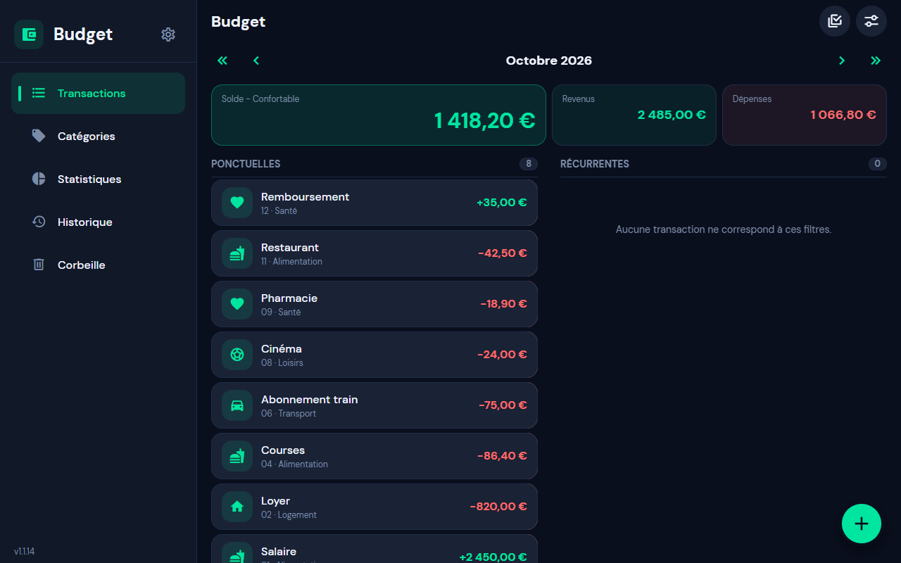
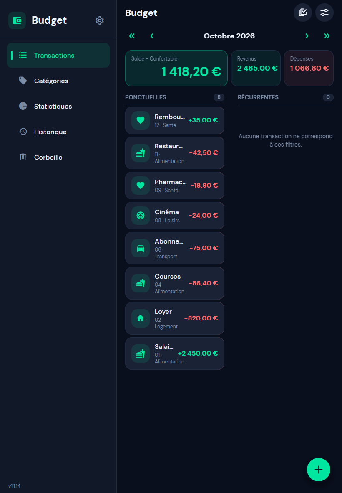
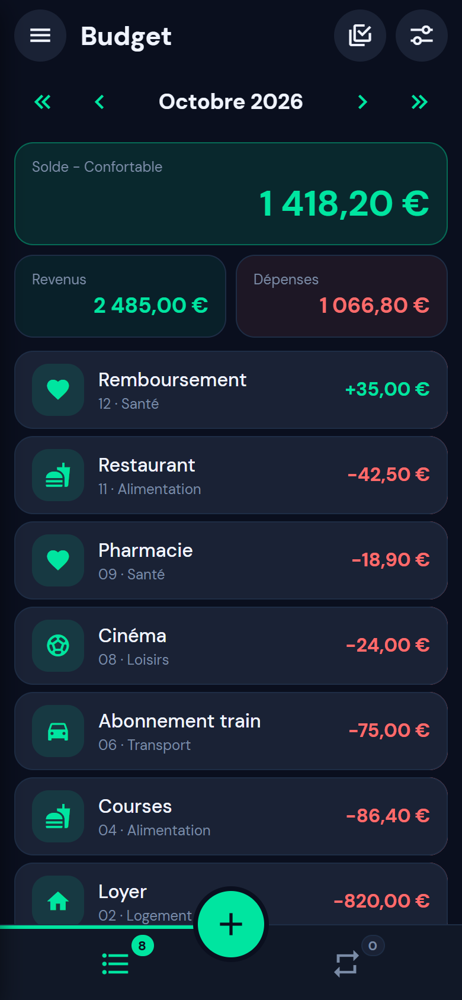

# Budget PWA

Application de budget installable dans un navigateur, construite avec Angular et TypeScript. Son interface reprend l’organisation et les couleurs de `budget-mobile`, avec une navigation adaptée au bureau et au téléphone.

La navigation utilise Angular Router : la coque est partagée entre les pages, et Transactions, Catégories, Statistiques, Historique et Réglages sont des composants routés chargés à la demande sur `/budget`, `/categories`, `/stats`, `/history` et `/settings`.

Le style utilise Tailwind CSS v4 (`src/styles.css`, thème sombre/clair via variables `--c-*`) et reproduit à l’identique l’UX/UI de `budget-mobile` : tiroir, barre de mois, feuilles modales, onglets avec bouton flottant, lignes à balayer, graphiques SVG. L’import bancaire n’est volontairement pas repris. Les composants réutilisables sont dans `src/app/shared/` (`chrome/` : en-tête, barres et sélecteur de mois ; `overlays/` : feuilles, dialogues, messages, verrouillage, présentation ; `charts/` : graphiques ; `controls/` : ligne à balayer, focus automatique) et les écrans dans `src/app/pages/`. Les services sont rangés par rôle : `src/app/data/` (budget, échéancier, stockage, profils), `src/app/preferences/` (réglages, textes), `src/app/sync/` (calendrier, archive de configuration), `src/app/security/` (verrouillage, secrets), `src/app/ui/` (dialogues, tiroir, messages, icônes, mise en page) et `src/app/pwa/` (installation, mises à jour, version, navigation).

## Aperçu

| Bureau | Tablette | Mobile |
| --- | --- | --- |
|  |  |  |

## Fonctionnalités

- **Échelonnement annuel** : une récurrence mensuelle peut n'être due que N mois par an (« EDF 180 € sur 10 mois, tous les ans ») : N mois consécutifs à partir de la date de départ, puis une pause jusqu'au même mois l'année suivante. Les applications bureau et mobile ne le proposent pas et le perdent si la série y est modifiée.
- **Catégories supprimables par balayage** : glisser une catégorie vers la gauche révèle la suppression ; elle part dans la corbeille (section « Catégories »), d'où elle se restaure (balayage vers la droite) ou se supprime définitivement ; « Vider la corbeille » les efface aussi. Stockage : `budget-pwa:trash-categories:v1`, propre à chaque profil.
- **Échéancier** (`/schedule`) : les prochaines occurrences des transactions récurrentes, regroupées par mois avec revenus, dépenses et solde, sur 1, 3, 6 ou 12 mois.
- **Profils** (Réglages > Général > Profils, `/settings/profiles`) : plusieurs jeux de données indépendants (transactions, catégories, récurrences, réglages, synchronisation du calendrier et son mot de passe). Changer de profil recharge l'application ; le profil actif ne peut pas être supprimé.
- Transactions par mois : création, modification, suppression, recherche, filtre revenu/dépense et récurrences quotidiennes, hebdomadaires (plusieurs occurrences par mois, à partir du jour de la transaction), mensuelles, bimestrielles, trimestrielles, semestrielles, annuelles ou personnalisées (tous les N jours, semaines, mois, bimestres, trimestres, semestres ou années, de 1 à 60), avec une durée limitée par un nombre d'occurrences et/ou un dernier mois.
- Catégories, indicateurs de solde, statistiques par catégorie et historique.
- Réglages de devise, langue de formatage, thème et seuils du solde.
- Export et restauration de sauvegardes JSON au format commun de `budget-lib`.
- Export et import de la configuration (réglages, seuils, accès au calendrier et son mot de passe) dans un fichier chiffré par une phrase secrète, pour la reprendre sur un autre appareil.
- Synchronisation optionnelle des transactions via un calendrier CalDAV.
- Service worker Angular pour la mise en cache de l’application et son ouverture hors ligne.
- **À propos** (bouton d’information de l’en-tête des Réglages, `/settings/about`) : version de l’application, bibliothèques utilisées (version et licence) et ressources embarquées (police, icônes). La liste vient de `src/app/pwa/dependencies.json`, régénéré par `npm run dependencies:generate` à partir de `package.json` et des paquets installés (`node_modules`) ; ce script s’exécute automatiquement après `npm install` et avant `start`, `build`, `typecheck` et `test`, donc la liste suit chaque changement de bibliothèque. Les ressources (polices, icônes) sont déclarées dans `scripts/generate-dependencies.mjs`. Commitez le fichier généré.

## Développement

Node.js 22 ou plus récent (exigé par Angular CLI 22).

```sh
npm install
npm start
npm run typecheck
npm test
npm run build
```

Les tests unitaires (`src/app/**/*.spec.ts`) s’exécutent avec vitest via `ng test` (environnement jsdom, `localStorage` et IndexedDB simulés dans `src/test-setup.ts`) ; `npm run test:coverage` affiche la couverture.

### Tests de bout en bout

Les tests de bout en bout (`e2e/*.spec.ts`) utilisent [Playwright](https://playwright.dev) : ils lancent le serveur de développement sur le port 4300 puis pilotent l’application dans un vrai navigateur, avec trois tailles d’écran (`desktop` 1280×800, `tablet` 820×1180, `mobile` 390×844). Ils couvrent le premier lancement, la navigation, la création, la modification et la suppression de transactions, la corbeille, la multisélection, les réglages et l’absence de barre de défilement horizontale sur chaque page.

```sh
npm run e2e                          # tous les projets
npx playwright test --project=mobile # une seule taille d’écran
npm run e2e:ui                       # mode interactif
```

En local, c’est Google Chrome installé sur la machine qui est utilisé ; en CI (`CI=true`), installer Chromium avec `npx playwright install --with-deps chromium`. Chaque test part d’un budget de démonstration injecté dans `localStorage` (voir `e2e/fixtures.ts`). Le workflow `.github/workflows/tests.yml` exécute le contrôle de types, les tests unitaires et les tests de bout en bout à chaque push et pull request.

Pour installer la PWA, publier le build de production sur un hôte HTTPS puis utiliser l’action d’installation du navigateur. Le service worker est désactivé par le serveur de développement.

## Déploiement sur GitHub Pages

Le workflow `.github/workflows/deploy-pages.yml` publie l’application sur `https://cgreg21.github.io/budget-pwa/` à chaque push sur `master` (ou manuellement via *Run workflow*). Il clone `budget-lib` à côté de l’application, car `package.json` la référence par `file:../budget-lib`, puis exécute `npm run build:pages -- --base-href /<nom-du-dépôt>/`, copie `index.html` en `404.html` pour que les liens profonds (`/budget-pwa/stats`, …) tombent sur le routeur Angular, et ajoute `.nojekyll`.

Activation, une seule fois, dans les réglages du dépôt : **Settings → Pages → Build and deployment → Source : GitHub Actions**.

Le manifeste utilise `start_url` et `scope` relatifs (`./`), et le service worker est enregistré par un chemin relatif : l’application fonctionne donc aussi bien à la racine d’un domaine que dans un sous-répertoire. Pour reproduire le build localement :

```sh
npm run build:pages -- --base-href /budget-pwa/
```

Le serveur CalDAV doit autoriser l’origine `https://cgreg21.github.io` (voir [CORS et hébergement web](#cors-et-hébergement-web)).

## Stockage et confidentialité

Les transactions, catégories, récurrences et seuils sont conservés dans le `localStorage` du navigateur, sous la clé `budget-pwa:data:v1`. Le profil « Principal » garde les clés d'origine (`budget-pwa:data:v1`, `…:trash:v1`, `…:settings:v1`, `…:calendar*:v1`) ; les autres profils utilisent les mêmes clés préfixées `budget-pwa:profile:<id>:` et un mot de passe CalDAV distinct (`calendar-password:<id>`). La liste des profils est dans `budget-pwa:profiles:v1`. Sans synchronisation activée, les données restent locales. Lorsque le calendrier est activé, seules les transactions et la liste des catégories sont échangées avec le serveur CalDAV choisi. Les sauvegardes JSON restent exportées et restaurées manuellement depuis les réglages. Le contenu local n’est pas chiffré : protégez l’accès au profil de navigateur et exportez régulièrement une sauvegarde.

### Configuration chiffrée

Dans la section **Sauvegarde** des réglages, **Exporter la configuration** produit un fichier `budget-config-AAAA-MM-JJ.budgetcfg` contenant les réglages généraux, les seuils du solde, l’accès au calendrier (URL, identifiant, **mot de passe**) et l’adresse du proxy CORS. Le fichier est chiffré par `budget-lib` (`config-archive` : PBKDF2-SHA256, AES-256-CBC et HMAC-SHA256 via WebCrypto) avec une phrase secrète d’au moins 8 caractères, demandée et confirmée au moment de l’export ; sans elle, rien n’est récupérable, ni par l’application ni par quiconque. **Importer une configuration** demande la phrase secrète, applique les réglages, les seuils et l’accès au calendrier, et enregistre le mot de passe dans le stockage chiffré de l’appareil (un fichier sans mot de passe conserve celui déjà connu). Le format est commun aux applications bureau et mobile ; la section bancaire d’un fichier venant du bureau est ignorée, la PWA n’ayant pas d’import bancaire. Les transactions ne font pas partie de ce fichier : utilisez la sauvegarde JSON ou la synchronisation CalDAV.

## Synchronisation avec un calendrier CalDAV

Dans les réglages, renseignez l’URL de la collection de calendrier (par exemple `https://cloud.example.com/remote.php/dav/calendars/user/budget`), l’identifiant et le mot de passe, puis testez la connexion et activez la synchronisation. Utilisez de préférence un calendrier dédié et un mot de passe d’application. Les transactions de tous les mois deviennent des événements sur toute la journée, partagés entre bureau, mobile et web via `budget-lib`. Les autres événements du calendrier ne sont pas modifiés.

Les modèles de récurrence, seuils et réglages restent locaux. Les occurrences sont des transactions ordinaires dans le calendrier, sans récurrence CalDAV ; leur identifiant de récurrence est conservé pour ne pas les recréer lors de l’application d’un modèle local. Les catégories (noms, icônes, ordre) sont synchronisées par un événement supplémentaire du calendrier (`categories@budget`) : en cas de modification des deux côtés, le calendrier prime pour l'ordre et les icônes, et les catégories uniquement locales sont conservées. La suppression d'une catégorie n'est pas propagée (union des listes) ; les anciennes versions ignorent cet événement. Les catégories manquantes des transactions reçues sont ajoutées avec l'icône par défaut.  En cas de modifications simultanées, la version du calendrier prend la priorité. Les suppressions sont propagées dans les deux sens ; les conflits de version refusés par le serveur sont signalés et retentés à la prochaine synchronisation.

La synchronisation est sérialisée, automatique au démarrage lorsqu’elle est activée, environ deux secondes après une modification locale, au retour de la connexion ou au premier plan. Le bouton **Synchroniser maintenant** permet aussi de la lancer. Les changements faits pendant une synchronisation sont conservés et traités au passage suivant. Hors ligne, les modifications restent possibles et enregistrées localement.

La configuration non secrète est enregistrée sous `budget-pwa:calendar:v1` et la référence de synchronisation (avec la date du dernier passage) sous `budget-pwa:calendar-baseline:v1`. Changer de calendrier ou d’identifiant réinitialise cette référence et oublie le mot de passe. **Le mot de passe est conservé chiffré sur l’appareil** (`src/app/security/secrets.ts`) : une clé AES-GCM 256 bits non extractible est générée à la première utilisation et stockée comme `CryptoKey` dans IndexedDB (`budget-pwa-secrets`), le chiffré étant rangé à côté ; la clé ne peut pas être exportée par du script et le mot de passe n’apparaît jamais en clair dans `localStorage` ni dans les sauvegardes. Si le navigateur ne le permet pas (mode privé, stockage effacé), le mot de passe ne vit que le temps de la session et l’écran le signale.

### CORS et hébergement web

Le transport utilise `fetch`. Le serveur CalDAV doit autoriser l’origine HTTPS de la PWA via CORS, y compris les requêtes de précontrôle `OPTIONS`, les méthodes **PROPFIND, REPORT, PUT, DELETE**, les en-têtes **Authorization, Depth, Content-Type, If-Match, If-None-Match**, et exposer **ETag** via `Access-Control-Expose-Headers`. Une PWA servie en HTTPS doit utiliser un calendrier HTTPS pour éviter le blocage du contenu mixte. Une erreur réseau ou un refus CORS apparaît comme un état hors ligne ; une authentification refusée ou une erreur HTTP est affichée comme une erreur. Le service worker continue de mettre en cache l’application, pas les identifiants ni les appels CalDAV.

Les hébergeurs grand public (Infomaniak, Murena, Disroot, Mailo…) n’envoient pas d’en-têtes CORS. Pour les utiliser depuis la PWA, déployez le proxy du projet voisin [`budget-caldav-proxy`](../budget-caldav-proxy/README.md) (Worker Cloudflare gratuit) et saisissez son adresse dans le champ **Proxy CORS** des réglages Calendrier ; l’URL du calendrier reste celle du serveur. La PWA envoie alors chaque requête au Worker en gardant le chemin et en indiquant le serveur dans un en-tête `X-Upstream`. Ce réglage est propre à la PWA (stocké dans `localStorage`, clé `budget-pwa:calendar-proxy:v1`) ; les applications mobile et bureau n’en ont pas besoin.
